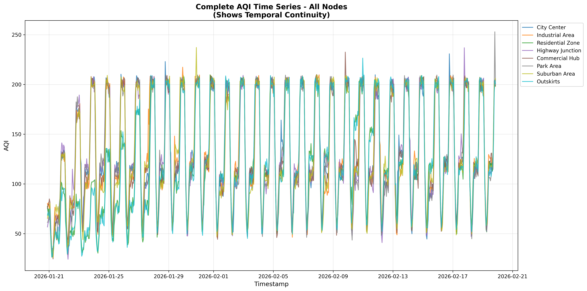
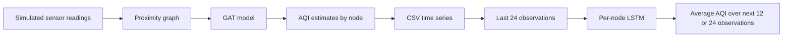
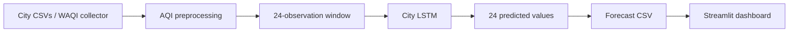
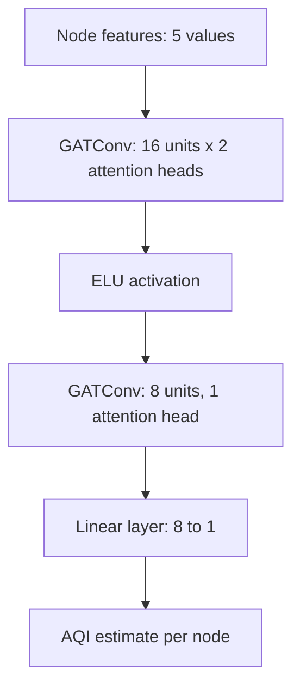
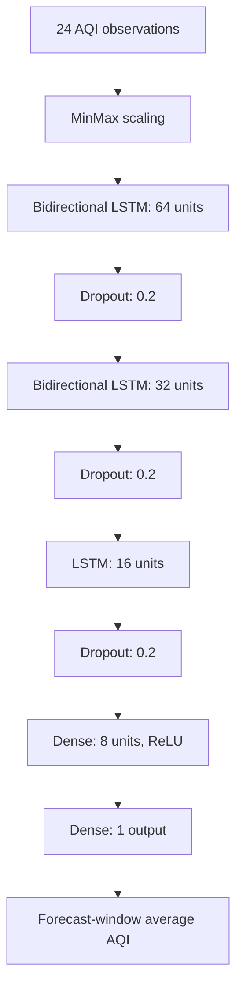
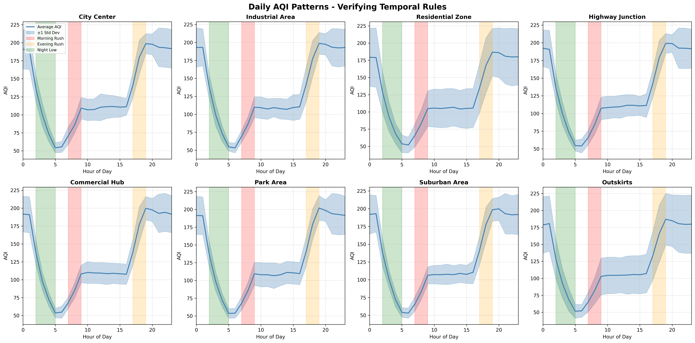
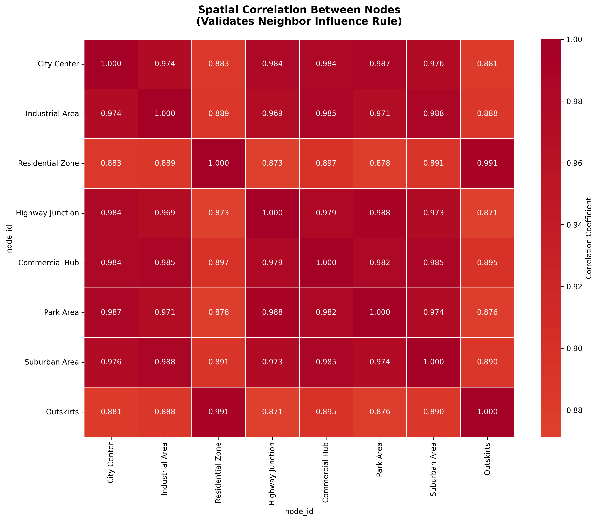
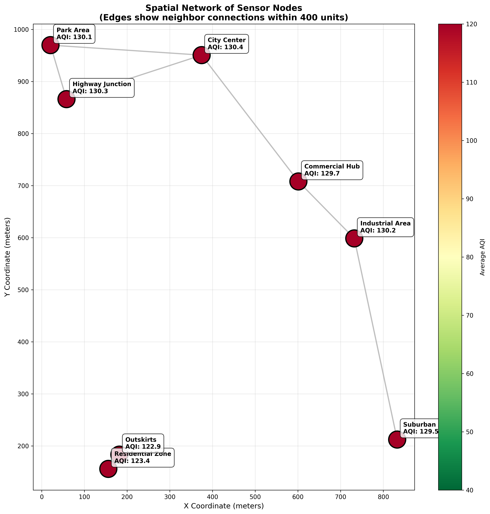
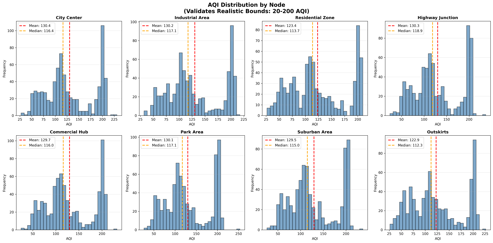
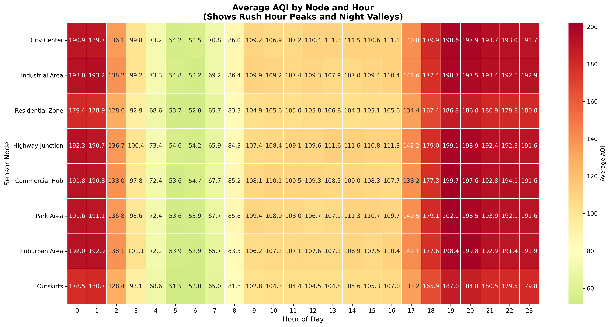

# Air Quality Prediction System using LSTM–GAT

Predicting air quality means understanding both how pollution changes over time and how nearby locations influence one another. This project explores those two ideas using Graph Attention Networks (GAT) for spatial relationships and Long Short-Term Memory (LSTM) networks for forecasting.

It includes an eight-node experimental pipeline, a separate LSTM workflow for Delhi, Mumbai, and Bengaluru, saved model files, and dashboards for exploring forecasts.



## What the project includes

- A synthetic sensor network with eight locations and five input features.
- A GAT model that estimates an AQI-like value at each node.
- Per-node LSTM models that predict average AQI over the next 12 or 24 observations.
- City LSTM models that produce a sequence of 24 future AQI values.
- A Streamlit dashboard with city selection, interactive charts, and CSV downloads.
- An HTML demonstration dashboard and six saved analysis plots.

## How it works

The spatial and temporal models run as separate stages. They are not trained together as a single neural network.



The GAT evaluation script can write predictions to the AQI log. The bundled log is consistent with the synthetic generator output; the archive does not establish that it contains GAT predictions.

### City forecasting workflow



The Streamlit dashboard displays saved forecast CSVs. Predictions are generated separately by the Python script.

## Model architecture

### Graph Attention Network

Each node has five features: PM2.5, PM10, MQ135, temperature, and humidity. Nodes are connected when their simulated coordinates are less than 400 units apart.



Training uses 1,000 graph snapshots, a 70%/15%/15% train–validation–test split, Adam with a learning rate of 0.005, and mean squared error loss. It runs for up to 150 epochs, with early stopping after 20 epochs without validation improvement. Normalization is fitted on the training snapshots.

### Node forecasting models



There are 16 saved node models: one for each combination of eight nodes and two forecast horizons. They use Huber loss, Adam with a learning rate of 0.001, a batch size of 32, and up to 100 epochs. The sequences are split chronologically into 80% training and 20% testing; 20% of the training portion is used for validation.

### City models

Each city model uses `LSTM(64) → Dropout(0.2) → LSTM(32) → Dropout(0.2) → Dense(24)`. It takes 24 AQI observations and returns 24 values. Training uses Adam, MSE loss, a batch size of 32, and 200 epochs.

## Data

### Eight-node network

The root `aqi_log.csv` contains **5,768 records**, with **721 observations per node**. Its columns are `timestamp`, `node_id`, `place_name`, and `aqi`.

| Node ID | Location used by the scripts |
| --- | --- |
| 0 | City Center |
| 1 | Industrial Area |
| 2 | Residential Zone |
| 3 | Highway Junction |
| 4 | Commercial Hub |
| 5 | Park Area |
| 6 | Suburban Area |
| 7 | Outskirts |

The bundled CSV uses `Area_0` through `Area_7` as its location labels. The synthetic generator simulates rush-hour increases, nighttime reductions, neighboring-node influence, and occasional pollution spikes.

Its target is calculated as:

```text
AQI-like target = 0.6 × PM2.5 + 0.3 × PM10 + 0.1 × (MQ135 / 3)
```

This formula is part of the simulation and does not implement an official AQI calculation standard.

### City datasets

| City | File | Records |
| --- | --- | ---: |
| Delhi | `lstm_model/data/delhi.csv` | 107 |
| Mumbai | `lstm_model/data/mumbai.csv` | 107 |
| Bengaluru | `lstm_model/data/bengaluru.csv` | 106 |

The city CSVs contain timestamps, AQI, pollutant readings, and weather-related fields. The city models use only the AQI column. The collector in `city_aqi.py` requests WAQI data and supports hourly collection.

The bundled city observations are irregularly spaced. The model therefore learns over observation steps; treating these as hourly forecasts requires resampling and validating the timestamps first.

## Project structure

```text
.
├── gat_model/
│   ├── config.py
│   ├── data/sample_aqi.py
│   ├── models/gat.py
│   ├── train_gat.py
│   ├── eval_gat.py
│   └── visualize_aqi.py
├── lstm_gat/
│   ├── train_lstm.py
│   ├── predict_lstm.py
│   ├── dashboard.html
│   └── saved_models/metrics.json
├── lstm_model/
│   ├── app1.py
│   ├── data/
│   │   ├── city_aqi.py
│   │   ├── delhi.csv
│   │   ├── mumbai.csv
│   │   └── bengaluru.csv
│   └── model/
│       ├── train_aqi.py
│       ├── predict_aqi.py
│       ├── <city>_model.h5
│       ├── <city>_scaler.npy
│       └── <city>_predictions.csv
├── saved_models/
│   ├── config.pkl
│   ├── node_<id>_<horizon>h.keras
│   └── node_<id>_<horizon>h_scaler.pkl
├── aqi_log.csv
├── gat_weights.pth
├── norm_stats.pt
├── aqi_distribution.png
├── hourly_heatmap.png
├── node_network.png
├── spatial_correlation.png
├── temporal_patterns.png
└── time_series_overview.png
```

`<city>` is `delhi`, `mumbai`, or `bengaluru`. Node model files are stored in the root `saved_models/` directory. The nested `lstm_gat/saved_models/` directory contains the archived metrics JSON.

## Getting started

Clone the repository and open its folder:

```bash
 git clone https://github.com/trivedivaishnavi/AQI-prediction-system.git
 cd AQI-prediction-system
```

The commands below assume this directory contains `gat_model/`, `lstm_gat/`, `lstm_model/`, and `aqi_log.csv`. If these are inside an additional `AQI model/` folder, enter that folder first.

### Set up an environment

On Windows PowerShell:

```powershell
python -m venv .venv
.\.venv\Scripts\Activate.ps1
```

On macOS or Linux:

```bash
python3 -m venv .venv
source .venv/bin/activate
```

Install the packages used by the source:

```bash
python -m pip install --upgrade pip
python -m pip install numpy "pandas>=2.0" scikit-learn tensorflow keras torch torch-geometric matplotlib seaborn streamlit altair requests h5py
```

The archive does not include pinned package versions. This list is based on imports in the code; compatibility with the saved models still needs to be checked in the chosen environment. Pandas 2.0 or later is needed for the city scripts' mixed timestamp parsing.

## Running the project

### Predict AQI for a node

From the project root:

```bash
python lstm_gat/predict_lstm.py
```

Enter a node ID between `0` and `7`, then choose `12` or `24`. Enter `q` to exit. The result is one estimate of average AQI over the chosen forecast window.

### Open the Streamlit dashboard

```bash
cd lstm_model
python -m streamlit run app1.py
```

Open the local URL printed in the terminal. Choose a city to view its saved forecast, explore the chart, or download the data. The app must run from `lstm_model/` because it uses a relative `model/` path. Use `cd ..` to return to the project root afterward.

### Generate city forecasts

From the project root:

```bash
python lstm_model/model/predict_aqi.py
```

Choose `12` or `24` when prompted. The model produces 24 values; choosing 12 exports the first 12. The script replaces each city's prediction CSV in `lstm_model/model/`.

### Train models

Run the relevant command from the project root:

| Task | Command |
| --- | --- |
| Train node LSTMs | `python lstm_gat/train_lstm.py` |
| Train city LSTMs | `python lstm_model/model/train_aqi.py` |
| Train GAT | `python gat_model/train_gat.py` |
| Evaluate a GAT snapshot | `python gat_model/eval_gat.py` |
| Generate 720 timesteps of GAT predictions | `python gat_model/eval_gat.py generate 720` |
| Generate analysis plots | `python gat_model/visualize_aqi.py` |

Training replaces the corresponding saved model files. Node training also writes a new `metrics.json` to the root `saved_models/` directory.

**Back up `aqi_log.csv` before running the GAT scripts.** Their import of `sample_aqi.py` currently generates 720 timesteps and overwrites the log. Evaluation then appends its predictions to that generated data. Move the generator's final statements inside an `if __name__ == "__main__":` guard before using the stages as a reproducible pipeline.

### View the HTML demo

```bash
python -m http.server 8000 --directory lstm_gat
```

Open [the local dashboard](http://localhost:8000/dashboard.html). It uses Chart.js from a CDN, so its charts require internet access.

The page is a demonstration: several charts and its prediction interaction use simulated JavaScript values rather than Python model inference. It reads the nested metrics JSON, but its accuracy code expects `accuracy_10` instead of the file's `accuracy` field.

### Collect city data

Before using `lstm_model/data/city_aqi.py`, replace its hardcoded token assignment with:

```python
WAQI_TOKEN = os.environ.get("WAQI_TOKEN", "YOUR_WAQI_TOKEN_HERE")
```

Set your own `WAQI_TOKEN` environment variable locally, then run:

```bash
python lstm_model/data/city_aqi.py
```

The script collects once and asks whether to continue hourly. It updates the city CSVs and removes records older than 60 days. Keep credentials out of the repository. Any token already published should be revoked or rotated by its owner.

## Recorded results

These figures come from the bundled [metrics file](lstm_gat/saved_models/metrics.json). They have not been independently reproduced or verified against the included checkpoints.

MAE and RMSE are in AQI units. “Within ±10” means the percentage of forecasts whose absolute error is at most 10 AQI units; it is a regression tolerance measure. The targets are forecast-window averages.

| Node | 12-step MAE | 12-step RMSE | Within ±10 (%) | 24-step MAE | 24-step RMSE | Within ±10 (%) |
| --- | ---: | ---: | ---: | ---: | ---: | ---: |
| 0 | 6.66 | 8.78 | 79.56 | 4.75 | 5.81 | 91.11 |
| 1 | 3.13 | 3.85 | 100.00 | 1.81 | 2.31 | 100.00 |
| 2 | 8.44 | 10.03 | 63.50 | 3.90 | 5.64 | 88.15 |
| 3 | 10.23 | 12.24 | 49.64 | 6.51 | 7.45 | 81.48 |
| 4 | 3.29 | 4.09 | 99.27 | 4.43 | 4.72 | 100.00 |
| 5 | 7.88 | 10.47 | 74.45 | 6.95 | 7.88 | 70.37 |
| 6 | 6.03 | 7.71 | 79.56 | 3.57 | 4.50 | 95.56 |
| 7 | 5.40 | 6.69 | 84.67 | 3.98 | 4.96 | 96.30 |

Each 12-step model has 137 recorded test samples; each 24-step model has 135. No separate saved numerical evaluation report is included for the GAT or city models. These synthetic-data results do not establish real-world forecasting performance.

## Explore the data

### Daily patterns



### Relationships between locations



### Sensor network



### AQI distributions



### Hourly patterns



These plots describe the bundled synthetic log and simulated coordinates. The visualization script can also generate a statistical summary plot.

## Current limitations

- Both LSTM training scripts fit scalers before splitting the full series. Overlapping forecast windows also cross split boundaries. Evaluation should be revised to avoid information leakage.
- The city training script uses its held-out portion as validation data during training. A separate test period is needed for an independent final evaluation.
- The HTML demo needs a real inference backend and a corrected metrics field. Retraining writes metrics to a different folder from the one this page reads.
- The Streamlit card labeled “Latest AQI” shows the final forecast value, not a live measurement. Its simplified AQI categories also need review against the intended standard.
- Dependency versions and complete training seeds are not recorded. Training and inference have not been verified in a clean environment for this README.

## Next steps

Useful improvements include regularly sampled station data, train-only preprocessing, persistence baselines, reproducible environment settings, and dashboard integration with model inference. A jointly trained spatial and temporal model is another possible direction.
